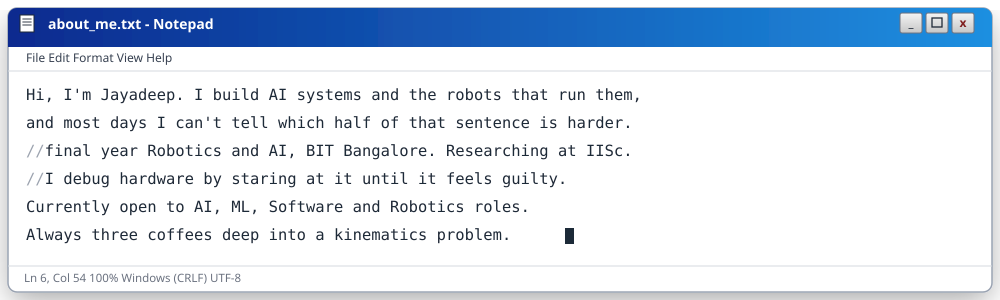
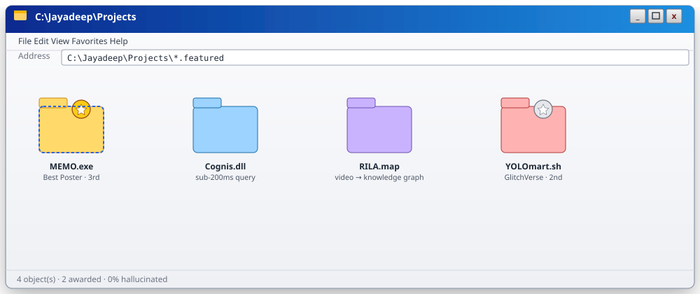

<div align="center">



<br/>

<a href="https://jayadeepgowda.vercel.app"></a>
<a href="https://linkedin.com/in/jay7788"></a>
<a href="mailto:jayadeepgowda24@gmail.com"></a>
<a href="https://github.com/jay7-tech/Record_Acc/raw/main/public/JayadeepGowda_CV.pdf"></a>

</div>

<br/>

<div align="center">

</div>

<br/>

<table width="100%">
<tr>
<td width="50%" valign="top">

**📍 right now**
Final-year Robotics & AI @ BIT Bangalore, Research Intern @ CDS, IISc — benchmarking ML/DL models on sensor data by day, teaching a quadruped to walk by night.

</td>
<td width="50%" valign="top">

**🎯 looking for**
Robotics / embedded-AI research roles. I reply faster to a well-written cold email than to most group chats.

</td>
</tr>
</table>

<br/>

---

<div align="center">

### 🖥️ Control Panel ▸ Add or Remove Programs

</div>

<div align="center">

`Core ML/DL`


<br/><br/>

`Robotics & Embedded`


<br/><br/>

`Systems & Tools`


</div>

<br/>

---

<div align="center">

### 💼 C:\JAYADEEP\EXPERIENCE&gt; dir /os

</div>

```text
 Volume in drive C is CAREER                      Directory of C:\JAYADEEP\EXPERIENCE

 03/2026   <RESEARCH>   IISc Bangalore, Dept. of CDS         Benchmarked 17 ML/DL models (CNN, BiLSTM,
                                                              CNN-LSTM) on MXene sensor data, 5-fold CV,
                                                              with AGH University, Poland.

 01/2026   <INTERN>     Sirena AI Systems — Robotics         Custom IK solvers + 12-state FSM gait
                                                              controllers. YOLOv8 + Whisper + Phi-2 on
                                                              ARM, sub-50ms ZeroMQ IPC.

 06/2025   <INTERN>     Frillory Design — AI Automation      LLM orchestration pipelines, 50+ enterprise
                                                              assets automated, −25% operational latency.

 ONGOING   <ACTIVE>     Robotics Club @ BIT — Jt. Secretary  Core organizer, Ideathon 2025 (600+ attendees).
                                                              R&D hardware, workshops, cross-team builds.

        4 File(s)       proof it wasn't luck
```

<br/>

---

<div align="center">

### 📂 C:\Jayadeep\Projects



</div>

<table width="100%">
<tr><td>

**🤖 MEMO — Neural-OS.** Six AI pipelines — vision, speech, a 4-bit Phi-2, vector memory — running at once on one Raspberry Pi 5, zero cloud. 🥉 Best Poster Presentation.

</td></tr>
<tr><td>

**🧠 Cognis.** N-gram pattern mining cuts LLM query tokens 40–60% with sub-200ms retrieval. Air-gapped, zero telemetry.

</td></tr>
<tr><td>

**🎥 RILA.** Turns raw video streams into a structured, queryable knowledge graph — PostGIS geospatial indexing meets ChromaDB semantic search.

</td></tr>
<tr><td>

**🛒 YOLOmart.** Autonomous shopping cart: 20 FPS / 92% mAP vision on custom ESP32 hardware, 8-hour battery life. 🥈 2nd place, GlitchVerse 2k25.

</td></tr>
</table>

<br/>

---

<div align="center">

### 📡 live telemetry
<sub>self-hosted via GitHub Actions — generated on a schedule, not fetched from a third-party API at view time</sub>

<br/><br/>


<br/><br/>


</div>

<br/>

<div align="center">

> 🪟 **Jayadeep.exe — Application Error**
> ```
> The operation at 0x0D15EA5E failed: TooManyGoodIdeasException.
> [ Debug ]   [ Ship It Anyway ]
> ```

</div>

<br/>

---

<div align="center">

<sub>Exploring Vision-Language-Action models & legged locomotion · open to robotics/AI research internships</sub>

<br/>

**[ INSERT COIN TO CONTINUE ]** — or just [email me](mailto:jayadeepgowda24@gmail.com).

</div>
